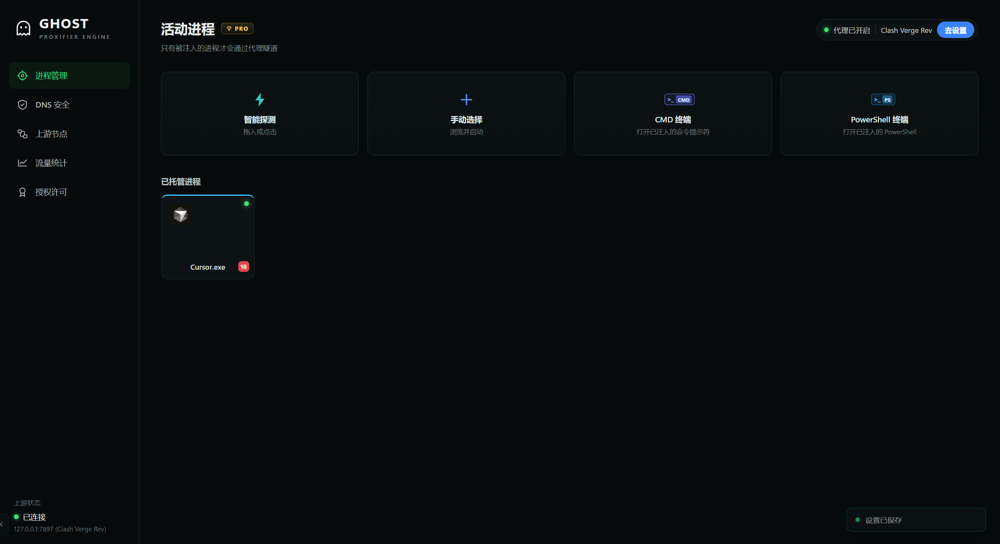
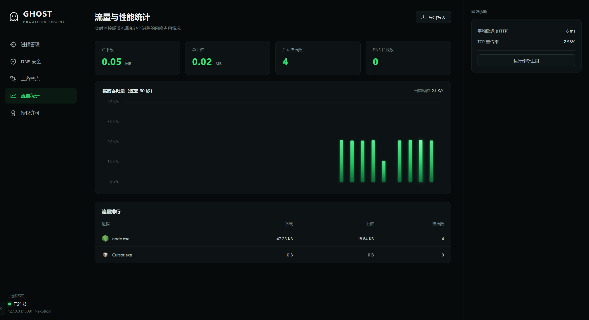
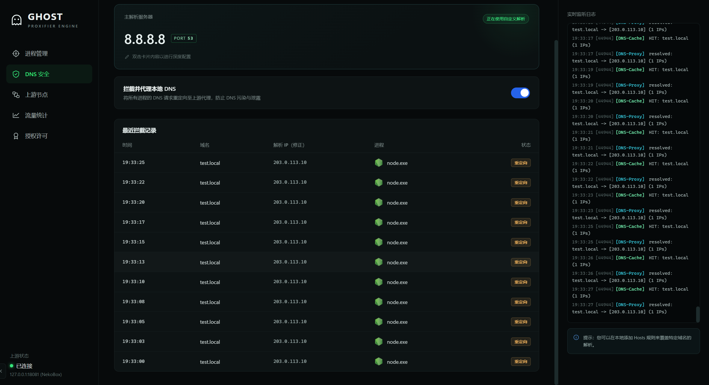
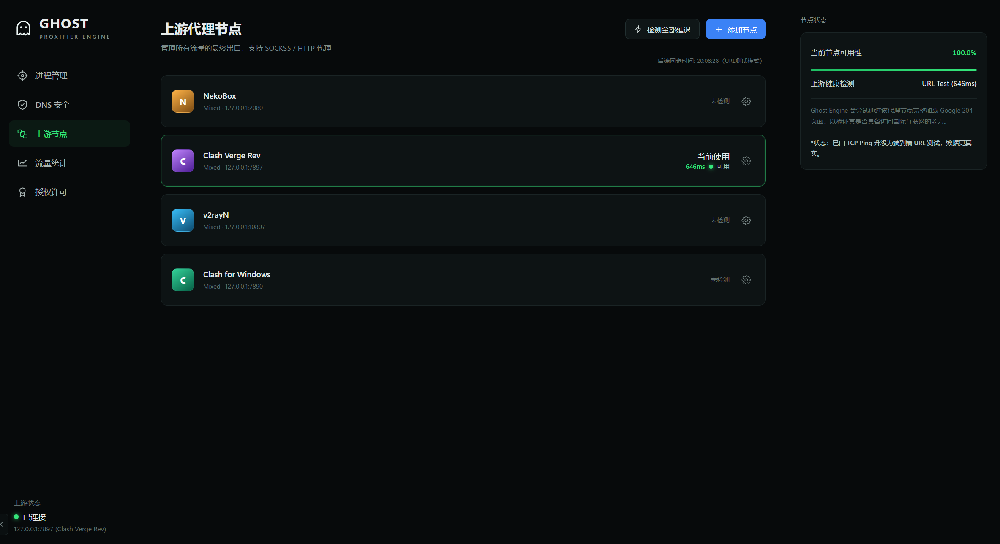
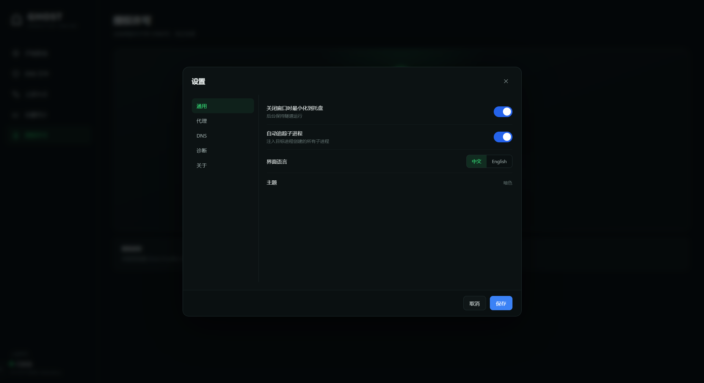
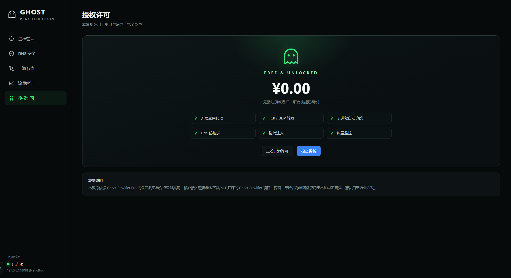
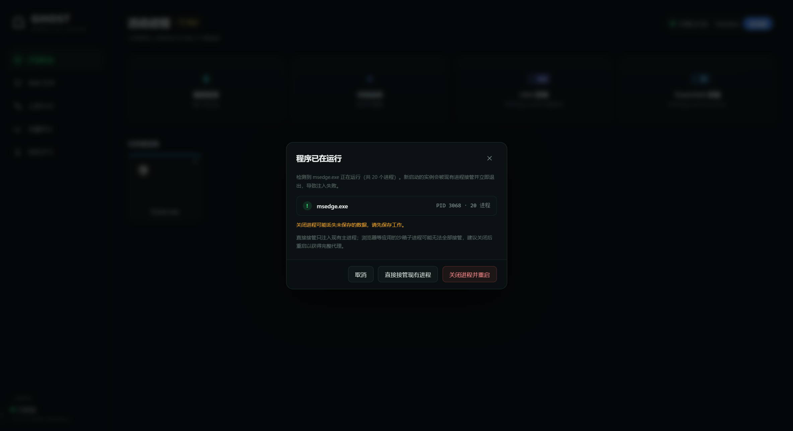
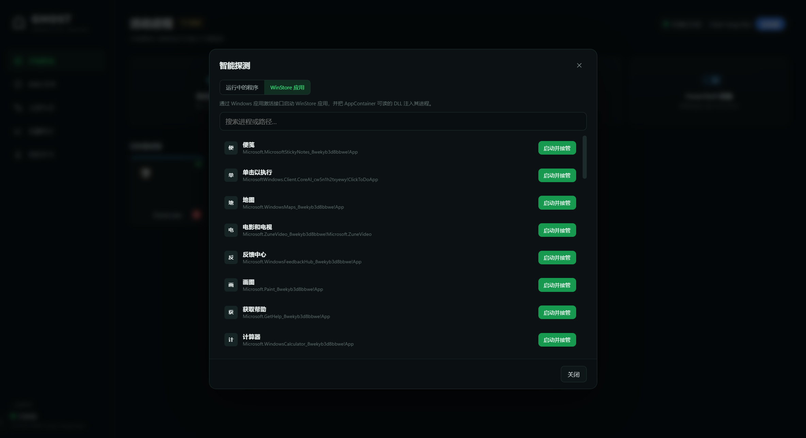
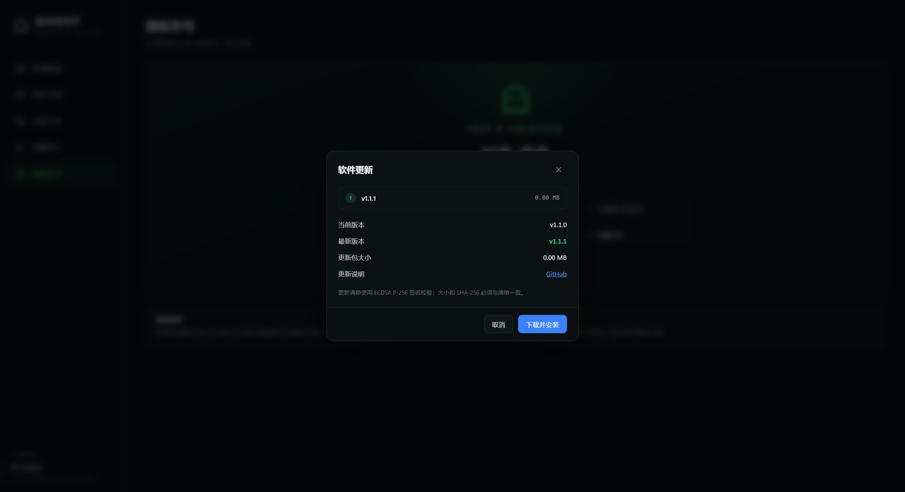

# Ghost Proxifier 复刻版

> 依据 [Ghost Proxifier Pro](https://github.com/liliBestCoder/ghost-proxifier-pro) 的公开截图、README 与介绍，结合其 MIT 开源的前身 [Ghost Proxifier](https://github.com/liliBestCoder/ghost-proxifier) 重新实现的 Windows 进程级透明代理。
>
> 本仓库是**学习与研究用途的复刻版**：界面、品牌名与图标仅用于本地对照测试，请勿用于商业分发。原版 Pro 是闭源软件；本复刻版不包含、也不反编译原版代码。

---

## 1. 它是什么

Ghost Proxifier 的核心思路：**不装 TUN/TAP 虚拟网卡、不写系统路由表、不用内核驱动**，只向用户选中的进程注入一个用户态 DLL，Hook Winsock / DNS API，把该进程（及其子进程）的 TCP、UDP、DNS 流量重定向到上游 HTTP / SOCKS5 / Shadowsocks 代理。

复刻版实现了：

- x64 进程注入（EntryDetour，优先；CreateRemoteThread 兜底）
- MinHook 用户态 API Hook：`connect` / `WSAConnect` / `ConnectEx` / `send` / `recv` / `WSASend` / `WSARecv` / `sendto` / `WSASendTo` / `recvfrom` / `WSARecvFrom` / `getpeername` / `closesocket` / `WSAIoctl`
- HTTP CONNECT、SOCKS5（含用户名/密码认证）与 Shadowsocks AEAD（aes-256-gcm / aes-128-gcm / chacha20-ietf-poly1305）三种上游
- 延迟握手（Lazy Handshake）：`connect` 只切换到代理地址，首次 `send` 时才完成 CONNECT，避免阻塞 Chrome/Node 的 IO 线程
- DNS 防泄漏：`getaddrinfo` / `GetAddrInfoW` / `gethostbyname` / `GetAddrInfoExW` / `DnsQuery_W/A` / `DnsQueryEx` 全部接管，DNS 查询经上游代理以 TCP 方式发往 `8.8.8.8:53` 等自定义解析器；同时维护 IP→域名映射，让 CONNECT 优先使用域名
- DoH 阻断（8.8.8.8:443 等）与 QUIC 阻断（UDP 443），强制浏览器回退标准 DNS / TCP
- **完整 UDP 转发**：本地 UDP 中继 + SOCKS5 UDP ASSOCIATE / Shadowsocks UDP AEAD，覆盖已连接与未连接 UDP、同步与 overlapped `WSASendTo`；同步 `recvfrom` 会把来源地址伪装回真实目标，`getpeername` 也返回真实目标
- **WinStore / UWP**：通过 `IApplicationActivationManager` 激活应用，把 DLL 复制到 AppContainer 可读目录并注入（ChatGPT、计算器等已验证）
- **签名自动更新**：ECDSA P-256 证书链 + 清单签名 + 大小/SHA-256 校验 + 允许前缀 + 吊销列表；支持 ZIP 自更新与 MSI
- **Watchdog**：托管进程注入丢失时自动重注入，记录上游可用性变化
- 子进程自动追踪、进程树注入、安全卸载（`GhostShutdown` + `FreeLibrary`）
- Electron + 原生 HTML/CSS/JS 复刻界面：进程管理、DNS 安全、上游节点、流量统计、授权许可、设置、实时日志、拖拽接管、智能探测（含 WinStore 标签页）、CMD/PowerShell 终端
- 上游 URL 健康检查、流量实时图表、每进程上下行/连接数、报表与排障包导出
- 已运行程序提示：可选择“关闭进程并重启”“直接接管现有进程”或取消

## 2. 界面截图

| 进程管理 | 流量统计 |
| --- | --- |
|  |  |
| **DNS 安全** | **上游节点** |
|  |  |
| **设置** | **授权许可** |
|  |  |

已运行程序的处理提示（关闭进程并重启 / 直接接管现有进程 / 取消）：



WinStore / UWP 应用标签页与签名更新弹窗：

| WinStore 应用 | 检查更新 |
| --- | --- |
|  |  |

## 3. 目录结构

```
出口流量管理工具/
├─ app/                         Electron 界面
│  ├─ main.js                   主进程：配置、进程管理、UDP 统计/日志、健康检查、导出
│  ├─ preload.js                contextBridge API（含拖拽路径解析）
│  └─ src/                      index.html / styles.css / app.js（渲染与图表）
├─ native/
│  ├─ core/                     注入到目标进程的 C++ 核心（gpp_core_x64.dll）
│  │  ├─ ghost_core.cpp         初始化、导出 GhostInit / GhostShutdown
│  │  ├─ hooks_socket.cpp       TCP/UDP Winsock Hook、延迟握手、QUIC 拦截
│  │  ├─ hooks_dns.cpp          各类 DNS API Hook
│  │  ├─ proxy.cpp              HTTP CONNECT / SOCKS5 握手
│  │  ├─ udp.cpp               完整 UDP 中继（SOCKS5 / Shadowsocks）
│  │  ├─ ss.cpp                 Shadowsocks AEAD TCP/UDP
│  │  ├─ dns.cpp / dns_cache.cpp / dns_pool.cpp
│  │  └─ config.cpp             INI 配置与热加载
│  ├─ ctl/                      gppctl.exe：注入/运行/UWP 激活/进程树/卸载/TCP 统计
│  ├─ minhook/                  MinHook（BSD 2-Clause）
│  └─ bin/                      编译产物（gpp_core_x64.dll、gppctl.exe）
├─ update/                      更新清单格式示例、签名密钥与说明
├─ tools/                       清单签名与测试清单生成工具
├─ test/                        本地回环测试工具（HTTP/SOCKS5/SS 服务器、假 DNS、UDP 回显、CDP 截图）
├─ dist/GhostProxifier-win32-x64/
│  └─ GhostProxifier.exe        已打包的便携版
└─ README.md
```

## 4. 快速使用

### 直接运行打包版

```
dist\GhostProxifier-win32-x64\启动 Ghost Proxifier.bat
```

或者双击 `dist/GhostProxifier-win32-x64/GhostProxifier.exe`。

建议把整个目录放在**可写目录**（不要放 `C:\Program Files`），因为原生组件会在 `resources/native/gpp_config.ini` 写配置。首次启动会创建默认节点：

- NekoBox — `127.0.0.1:2080`
- Clash Verge Rev — `127.0.0.1:7897`
- v2rayN — `127.0.0.1:10807`
- Clash for Windows — `127.0.0.1:7890`

在「上游节点」里选择你实际正在使用的代理，然后：

1. 把 `.exe` / `.lnk` / `.bat` / `.cmd` 拖进窗口，或点「智能探测」「手动选择」。
2. 如果目标已经在运行（尤其是 Edge/Chrome），会弹出：
   - **关闭进程并重启**：关闭该 exe 的所有进程，再重新启动并注入（会丢失未保存数据，界面有提示）
   - **直接接管现有进程**：仅注入现有主进程；浏览器沙箱子进程可能无法全部接管
   - **取消**
3. 进程卡出现后，它的 TCP 与 UDP 连接会经上游代理转发；DNS 按配置走代理。
4. 智能探测窗口的 **WinStore 应用** 标签页可直接启动并接管 UWP 应用（ChatGPT、Claude、计算器等）。首次使用会把 DLL 复制到 `C:\ProgramData\GhostProxifier` 并授予 `ALL APPLICATION PACKAGES` 读取权限。
5. 授权许可页可检查签名更新；设置 → 关于 里配置更新清单 URL 和自动检查开关。
6. 设置中的 **Watchdog** 默认开启：托管进程的注入丢失时会自动重新注入，并在日志面板记录上游可用性变化。

> 原版 README 也明确要求“注入前确保目标程序及其子进程已经完全退出”。浏览器的单例机制会让新启动的进程把请求交给已有实例后退出，因此“关闭并重启”是获得完整代理覆盖的推荐路径。

### 从源码运行

环境：Windows 10/11 x64、Node.js 20+、MinGW-w64 (UCRT, POSIX, SEH) 或 Visual Studio 2022、CMake 3.20+、Ninja。

```bash
# 1) 原生核心
cmake -S native -B build/native -G Ninja -DCMAKE_BUILD_TYPE=Release \
  -DCMAKE_C_COMPILER=<mingw>/bin/gcc.exe \
  -DCMAKE_CXX_COMPILER=<mingw>/bin/g++.exe
cmake --build build/native

# 2) Electron
cd app
npm install
npm start
```

本项目使用 WinLibs 便携式 MinGW 编译通过（GCC 16.2.0 / MinGW-w64 14.0.0 UCRT）。DLL 静态链接 libstdc++/libwinpthread，依赖系统 `KERNEL32`、UCRT、`WS2_32` 与 `bcrypt`（Shadowsocks AEAD）；`gppctl` 额外链接 `ole32/oleaut32`（UWP 激活）。

`app/update-root.pub.pem` 是内置的更新根公钥。私钥、签名证书与签名工具在 `update/` 和 `tools/`；正式发布前请替换成你自己的密钥对并妥善保护私钥。

## 5. 原版实现原理（分析结论）

完整代码级分析见 [`docs/IMPLEMENTATION.md`](docs/IMPLEMENTATION.md)，这里给结论：

1. **注入**：x64 下修改挂起线程的 `RCX` 为一段 shellcode，`RIP` 保持 `LdrInitializeThunk`。系统初始化完全部 DLL 后跳入 shellcode → `LoadLibraryW` → `GetProcAddress("GhostInit")` → 初始化 Hook → 跳回原 EXE 入口。这样 Hook 在目标进程最早的网络调用之前生效，且兼容 Cygwin（`GhostInit` 跑在收到 `DLL_PROCESS_ATTACH` 的首线程）。失败则回退 `CreateRemoteThread(LoadLibraryW)`。
2. **Hook**：MinHook 修改 `ws2_32.dll` / `dnsapi.dll` 函数入口。`ConnectEx` 必须提前 Hook，因为应用可能已经通过 `WSAIoctl(SIO_GET_EXTENSION_FUNCTION_POINTER)` 缓存了函数指针。
3. **延迟握手**：`connect`/`ConnectEx` 只把目标地址换成代理地址，目标 IP/域名放进 `PendingMap`；首次 `send`/`WSASend` 时 `select` 等待代理连接完成，再发 HTTP CONNECT。这样不会阻塞浏览器 IO 线程。
4. **域名优先**：DNS Hook 解析时记录 `IP→域名`，CONNECT 时优先用域名，让上游代理能按域名分流。
5. **DNS 防泄漏**：`getaddrinfo` 等 Hook 不调用系统 DNS，而是经上游代理打开到 `DNS_IP:53` 的 TCP 隧道，发送/解析 DNS 报文；另有本地 UDP DNS 网关把应用的 UDP 53 重定向到 127.0.0.1 随机端口，再转成 TCP-over-proxy；共享内存缓存跨进程复用结果。
6. **DoH / QUIC**：已知 DoH 服务器 IP 的 443 连接直接返回 `WSAECONNREFUSED`；UDP 443 返回 `WSAENETUNREACH` 并关闭 socket，迫使浏览器回退 TCP。
7. **统计/日志**：注入的每个进程通过 UDP 每 2 秒向 UI 的 45002 端口上报 PID/PPID/上下行/连接数/延迟/节点；日志走 45001。UI 用 PID 聚合进程树。
8. **Pro 版 GUI**：Electron 风格深色界面 + 原生 DLL/服务；进程卡、拖拽、智能探测、上游节点健康检查（URL Test）、DNS 拦截表、流量图、诊断、托盘、自动更新（签名清单）。复刻版已实现主要界面与能力，并补齐了 UDP、Shadowsocks、UWP、签名更新与 Watchdog。
9. **完整 UDP**：每个目标分配一个 127.0.0.1 本地 UDP 端点；应用对本地端点做普通（含 overlapped）读写，后台线程负责 SOCKS5 UDP ASSOCIATE / Shadowsocks UDP AEAD 的封装与解封装。这样不会改动应用缓冲区，也不依赖 IOCP 完成路径。
10. **Shadowsocks**：经典 AEAD 协议（aes-128-gcm / aes-256-gcm / chacha20-ietf-poly1305）；TCP 用 `salt + 长度/载荷分块加密`，UDP 每个数据报随机 salt 后整包 AEAD。密钥派生为 EVP_BytesToKey(MD5) + HKDF-SHA1("ss-subkey")。
11. **UWP**：`IApplicationActivationManager::ActivateApplication` 激活并取得 PID；DLL 复制到 AppContainer 可读目录并授予 `ALL APPLICATION PACKAGES` 读取权限，再通过 `inject --dll` 注入。
12. **签名更新**：根公钥验签书 → 证书验清单 → 检查 SKU/版本/URL 前缀/大小/SHA-256/吊销列表 → 下载校验 → ZIP 由 PowerShell 等待进程退出后解压并重启，或调用 MSI。
13. **Watchdog**：每 5 秒检查托管根进程的统计新鲜度与 DLL 是否仍加载；丢失则重新注入并记录事件，失败按 60 秒退避。

## 6. 已验证的能力

本地回环测试（`test/proxy.js` 提供 HTTP CONNECT、SOCKS5、假 DNS、TLS 204、UDP 回显；`test/ss-server.js` 提供 Shadowsocks AEAD TCP/UDP）：

| 场景 | 结果 |
| --- | --- |
| 挂起进程 EntryDetour 注入 Node | ✅ Hook 初始化日志、进程存活 |
| HTTP CONNECT 上游 | ✅ `OK 200 HELLO_FROM_PROXY_TARGET` |
| SOCKS5 上游 | ✅ `OK 200 HELLO_FROM_PROXY_TARGET` |
| DNS over TCP via proxy | ✅ `test.local → 203.0.113.10`，CONNECT 使用域名 |
| DoH 阻断 | ✅ `ECONNREFUSED` |
| QUIC 阻断 | ✅ `ENETUNREACH` |
| SOCKS5 UDP（Python sendto / connected / Node overlapped） | ✅ `ECHO:hello-udp`，来源地址伪装回目标 |
| Shadowsocks TCP + DNS（aes-128 / aes-256 / chacha20） | ✅ `DNS_OK 203.0.113.10 HTTP_OK 200` |
| Shadowsocks UDP（aes-128 / aes-256 / chacha20，sendto / connected） | ✅ `ECHO:node-sendto-udp from 1.1.1.1:9999` |
| Edge 独立实例（不同 user-data-dir） | ✅ 注入 4 个进程，代理日志出现 Edge CONNECT |
| WinStore/UWP（ChatGPT、计算器） | ✅ `ActivateApplication` + `isinjected:true` |
| 签名更新检查 | ✅ v1.0.0 → 1.0.1 可用；篡改清单被“更新清单签名无效”拒绝 |
| Watchdog | ✅ 手动卸载 DLL 后 32 秒自动重新注入 |
| 安全卸载 | ✅ `isinjected` 由 true 变 false，目标进程存活 |
| 打包版启动（v1.1.0） | ✅ `nativeReady=true`，UWP 中文名正常，Clash 节点健康检查通过 |

## 7. 已知限制

- **仅 x64 目标**：当前构建没有 x86 DLL/launcher。32 位程序会提示不支持；可额外用 i686 MinGW 构建 `gpp_core_x86.dll` 扩展。
- **HTTP 上游不支持 UDP**：HTTP 代理没有 UDP 语义；使用 HTTP 上游时非 DNS/QUIC 的外部 UDP 会被阻断（防止泄漏）。需要完整 UDP 请选择 SOCKS5 或 Shadowsocks。
- **UDP 来源地址**：同步 `recvfrom` 会把来源伪装回真实目标；带 `OVERLAPPED` 的 `WSARecvFrom` 由 I/O 管理器写来源地址，应用看到的来源是 127.0.0.1 的本地中继（数据本身正常）。已连接的 UDP 应用通常使用 `recv`，不受影响。SOCKS5 UDP 分片（FRAG≠0）不支持。
- **Shadowsocks 范围**：仅经典 AEAD（aes-128-gcm / aes-256-gcm / chacha20-ietf-poly1305）；不支持 SS2022、插件（obfs/v2ray-plugin）和 SIP003。BCrypt 不支持的系统上 chacha 会报“algorithm unavailable”。
- **UWP**：已验证 ChatGPT 与计算器；部分启用 ACG/CIG 或更严格 AppContainer 策略的应用仍可能拒绝注入。建议以管理员身份运行；`C:\ProgramData\GhostProxifier` 需要写入与 ACL 权限。WinStore 应用更新后路径变化由包路径匹配自动适应。
- **沙箱/受保护进程**：Chromium 的 GPU/渲染/网络服务进程可能启用 ACG/CIG 或 AppContainer，非管理员注入可能失败。复刻版会按 60 秒退避重试，并在界面不把它们计为已注入。
- **更新密钥是演示密钥**：`update/root-key.pem`、`app-key.pem` 在当前工作区用于示例；正式发布必须替换并保护私钥。更新包必须是包含完整便携版目录内容的 ZIP（或 MSI）；当前仅验证了签名/篡改拒绝与下载校验，正式自更新建议在测试机上先演练。
- **没有代码签名**：SmartScreen/杀软可能提示；这是 DLL 注入类工具的共性。
- **Watchdog 不会重启已退出的应用**：只恢复“进程仍在但注入丢失”的情况；应用崩溃后的自动重启不在范围内。
- **TCP 重传率是系统级**：`GetTcpStatistics` 取的是全机计数，不是单隧道统计。
- **配置与密码**：上游密码、SS 密码以明文保存在 `%APPDATA%/ghost-proxifier-replica/config.json`，并写入原生目录的 `gpp_config.ini`（以及 UWP 副本）。请仅在受控机器上使用。

## 8. 许可与致谢

- 注入核心基于 Ghost Proxifier（MIT）重写/扩展，许可证见 `native/core/LICENSE.ghost-proxifier`。
- Hook 引擎使用 [MinHook](https://github.com/TsudaKageyu/minhook)（BSD 2-Clause），许可证见 `native/minhook/LICENSE.txt`。
- “Ghost Proxifier”“Ghost Proxifier Pro”名称、图标与原始截图归原作者所有；本项目仅作本地学习与研究，不提供任何原版二进制。
- 请遵守当地法律与上游代理服务条款；不要用它进行未授权的网络监控或流量劫持。

## 9. 测试工具

`test/` 下是可复现的回环测试：

- `proxy.js`：HTTP CONNECT / SOCKS5 / UDP ASSOCIATE / 假 DNS / TLS 204 / UDP echo
- `ss-server.js`：Shadowsocks AEAD 测试服务器（TCP + UDP，aes-128/256-gcm、chacha20-ietf-poly1305）
- `agent.js`、`agent-loop.js`、`udp_agent.py`、`udp_agent2.py`、`udp_node.js`：被注入的测试负载（TCP/DNS/同步与 overlapped UDP）
- `cdp.js`、`cdp-watch.js`：通过 DevTools 协议截图、执行渲染器 JS、捕获报错
- `proxy.out`、`ss-server.log` 等运行产物可在测试后删除

测试代理只监听 `127.0.0.1:18080-18082/18443/18388`，不会影响真实网络；正式使用时请在上游节点里选择真实的 Clash/NekoBox 端口。

## 10. 签名自动更新

更新清单格式与发版流程见 [`update/README.md`](update/README.md)。示例：

```bash
# 1) 生成清单（示例脚本只用于本地验签测试）
node tools/make-test-update.js 1.1.1

# 2) 用 ECDSA P-256 签发 personal.json.sig
node tools/sign-update.js update/personal.json

# 3) 在 设置 → 关于 填写清单 URL，或在 config.json 设置
#    general.updateUrl = "https://your.host/update/personal.json"
```

应用会依次校验：根公钥 → 证书签名与有效期/吊销 → 清单签名 → SKU/版本/URL 前缀/大小/SHA-256 → 下载后再次校验大小与哈希。任一失败都不会下载或安装。ZIP 自更新会启动一个 PowerShell 脚本，等待当前进程退出后解压到程序目录并重启；MSI 更新调用 `msiexec /passive`。

> `update/root-key.pem` 与 `update/app-key.pem` 是演示私钥。正式发布请重新生成并只把 `root.pub.pem` 编译进程序（复制到 `app/update-root.pub.pem`）。
